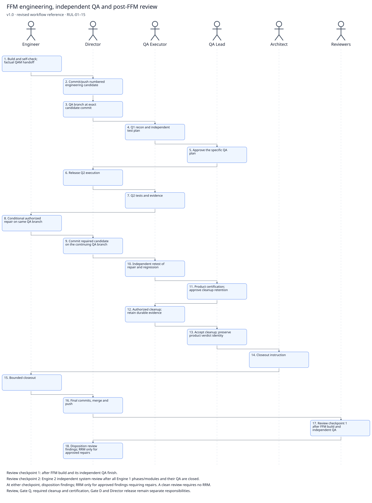

# FFM engineering, independent QA and post-FFM review

> **Version:** 1.0 · **Date:** 2026-10-18 · **Status:** Active reference
> **Governed by:** `FFM_PLAYBOOK.md`, `SOFTWARE_FACTORY_PLAYBOOK.md` §2, `RRM_PLAYBOOK.md` §2, `QAM_PLAYBOOK.md`, `DEPLOYMENT_PLAYBOOK.md`.

This revised workflow supersedes the August diagram `SRC-W02_FFM_EXECUTION.png` for current instructions when this proposed sync is approved, landed and verified. The [unaltered original](../../_AUDIT/SYNC_2026-10-15_doctrine-part2/INTAKE_SNAPSHOT/factory-intake/SOURCES/Workflow/SRC-W02_FFM_EXECUTION.png) remains historical evidence; it grants no current role, Git or cloud permission. This derivative follows RUL-01…15 and Tony’s explicit workflow/diagram correction assignment of 2026-10-16.

## Sequence

1. **Engineer:** Build and self-check; factual QAM handoff.
2. **Director:** Commit/push numbered engineering candidate.
3. **Director:** QA branch at exact candidate commit.
4. **QA Executor:** Q1 recon and independent test plan.
5. **QA Lead:** Approve the specific QA plan.
6. **Director:** Release Q2 execution.
7. **QA Executor:** Q2 tests and evidence.
8. **Engineer:** Conditional authorized repair on same QA branch.
9. **Director:** Commit repaired candidate on the continuing QA branch.
10. **QA Executor:** Independent retest of repair and regression.
11. **QA Lead:** Product certification; approve cleanup retention.
12. **QA Executor:** Authorized cleanup; retain durable evidence.
13. **QA Lead:** Accept cleanup; preserve product verdict identity.
14. **Architect:** Closeout instruction.
15. **Engineer:** Bounded closeout.
16. **Director:** Final commits, merge and push.
17. **Reviewers:** Review checkpoint 1 after FFM build and independent QA.
18. **Director:** Disposition review findings; RRM only for approved repairs.

## Review and release checkpoints

- Review checkpoint 1: after FFM build and its independent QA finish.
- Review checkpoint 2: Engine 2 independent system review after all Engine 1 phases/modules and their QA are closed.
- At either checkpoint, disposition findings; RRM only for approved findings requiring repairs. A clean review requires no RRM.
- Review, Gate Q, required cleanup and certification, Gate D and Director release remain separate responsibilities.

## Entry, handoff and evidence

Boot/resume through the module’s declared entry file: Engineering routes to its released implementation assignment; QA routes to `QAM/` as QA Executor. Read-only Git inspection and declared reporting writes are permitted; Tony performs all Git mutations. Requirements/acceptance freeze while declared handoff and QA evidence lanes remain writable. Preserve actual candidate, test-plan, repair/retest, cleanup and closeout identities; never prefill a verdict or planned commit SHA. Deployment additionally requires verified exclusion from build inputs and the actual artifact; a folder name is insufficient. Existing modules in flight keep their recorded sequence unless explicitly amended.

## Version History

| Version | Date | Change | Authority |
|---|---|---|---|
| 1.0 | 2026-10-18 | Revised workflow and stick diagram; original retained; review checkpoints and seat boundaries reconciled | MC-06; W01–W23; RUL-01–RUL-15; Tony 2026-10-16 correction assignment |
