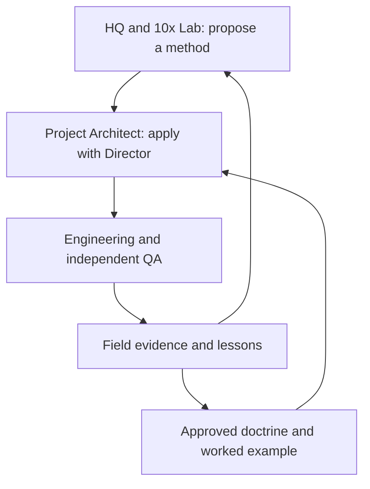

# JARVIS Master Operating Model

**Version 0.1 · 17 September 2026 · Director-defined structure; pilot documentation**

## Purpose

JARVIS Master is Stark Technologies headquarters. Tony and SOL/JARVIS Master maintain the cross-project view, develop reusable operating methods, and route work to the project teams with the right context. The 10x Lab is the invention and experimentation space. Successful methods become playbooks, manuals, templates and journals for App Factory, Web Factory, Stark AI Workbench, Cyber Pharma, DockBloxx and other projects.

Headquarters creates the method. Project teams apply it. Their evidence and lessons return to headquarters for the next revision. A clever idea becomes provisional guidance first; a successful field run supplies the worked example needed for mature doctrine.

## Authority and seats

| Seat | Responsibility | Boundary |
|---|---|---|
| Tony / Director | Priorities, scope approval, risk decisions, authorized Git/cloud actions, final release decisions | Retains final human authority |
| SOL / JARVIS Master at HQ | Cross-project coordination, communication, reusable doctrine and handoffs | Does not invent missing project truth or independently approve product scope |
| Project Architect, currently Fable | Current project analysis, findings reconciliation, proposed dispositions, module contracts, engineering instructions and final closeout instructions | Authors the project-specific RRM; escalates business decisions to Tony |
| Claudy / Engineer | Implements approved work, engineering checks, execution log, evidence handoff; performs Architect-directed repairs and closeout | Does not self-certify independent QA or silently change acceptance criteria |
| SOL / QA Lead | Independent QA strategy, test plans, evidence adjudication, Gate Q certification and durable QA package selection | QA entry follows engineering handoff; no routine engineering-packet approval role |
| Cody / QA Engineer | Executes QA, probes claims, records findings and retests; recommends disposition | Does not repair product code or substitute recommendation for SOL certification |
| Reviewer | Independent discovery and targeted re-review of accepted issues | Findings are advisory evidence; no automatic repair/release authority |
| Designer / DevOps / Support | Design, deployment and operational/support work within assigned scope | A QA-certified merge is not itself a deployment or Gate D |

Names identify seats. Models and tools can change without changing those responsibilities. Fable may be a project Architect in one session and an independent Reviewer in another; record which role produced each artifact. SOL's HQ and QA activities also need explicit role labels.

## Module vocabulary

| Module | Expansion supplied by Director | Purpose |
|---|---|---|
| FFM | Frontend First Module | Build an approved frontend-first surface |
| BIM | Backend Integration Module | Deliver bounded backend/integration work |
| ABM | Application Build Module | Application-build work; detailed lifecycle outside this pilot |
| RRM | Review Rework Module | Implement an approved disposition of review findings |
| TRM | Ticket Resolution Module | Resolve a bounded support/client ticket |

Module type describes purpose; it does not remove independent QA. This document does not rename existing module IDs or rewrite other playbooks.

## Three engines

1. **Build and QA:** deliver bounded modules, verify acceptance, clean and close out, merge under Tony.
2. **Review and improvement:** assess a completed phase or explicitly bounded earlier surface, adjudicate findings, implement RRMs, verify repairs and regression.
3. **Release review:** assess interactions across completed phases, close accepted release issues, and obtain appropriate release/deployment evidence.

An RRM can support Engine 2 or an Engine 3 repair campaign. Its certificate covers its approved scope. It does not automatically certify a whole phase, application or deployment.

## Knowledge flow

Each project returns concise evidence-backed lessons: what happened, why the current instruction helped or failed, the proposed change, and its supporting artifact. The project Architect maintains the project journal; seat-authored lessons retain their authorship and original meaning. HQ consolidates across projects. Canonical updates follow the existing controlled doc-set sync process.
