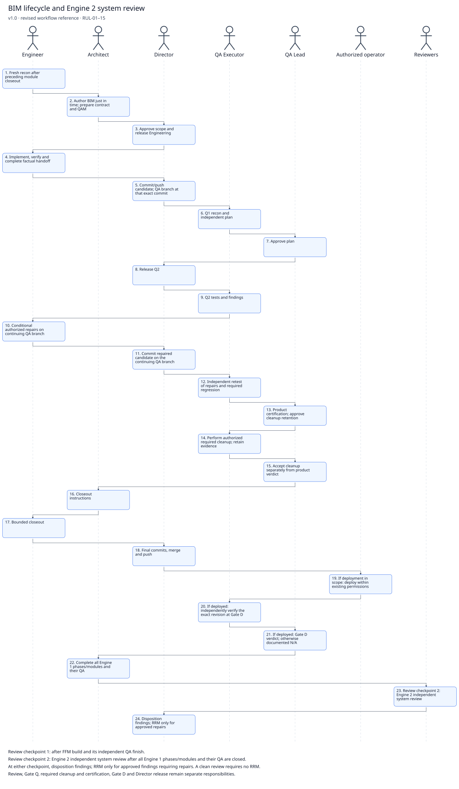

# BIM lifecycle and Engine 2 system review

> **Version:** 1.0 · **Date:** 2026-10-16 · **Status:** Proposed — pending verified publication
> **Governed by:** `BIM_PLAYBOOK.md`, `SOFTWARE_FACTORY_PLAYBOOK.md` §2, `RRM_PLAYBOOK.md` §2, `QAM_PLAYBOOK.md`, `DEPLOYMENT_PLAYBOOK.md`.

This revised workflow supersedes the August diagram `SRC-W04_BIM_WORKFLOW.png` for current instructions when this proposed sync is approved, landed and verified. The [unaltered original](../../_AUDIT/SYNC_2026-10-15_doctrine-part2/INTAKE_SNAPSHOT/factory-intake/SOURCES/Workflow/SRC-W04_BIM_WORKFLOW.png) remains historical evidence; it grants no current role, Git or cloud permission. This derivative follows RUL-01…15 and Tony’s explicit workflow/diagram correction assignment of 2026-10-16.

## Sequence

1. **Engineer:** Fresh recon after preceding module closeout.
2. **Architect:** Author BIM just in time; prepare contract and QAM.
3. **Director:** Approve scope and release Engineering.
4. **Engineer:** Implement, verify and complete factual handoff.
5. **Director:** Commit/push candidate; QA branch at that exact commit.
6. **QA Executor:** Q1 recon and independent plan.
7. **QA Lead:** Approve plan.
8. **Director:** Release Q2.
9. **QA Executor:** Q2 tests and findings.
10. **Engineer:** Conditional authorized repairs on continuing QA branch.
11. **Director:** Commit repaired candidate on the continuing QA branch.
12. **QA Executor:** Independent retest of repairs and required regression.
13. **QA Lead:** Product certification; approve cleanup retention.
14. **QA Executor:** Perform authorized required cleanup; retain evidence.
15. **QA Lead:** Accept cleanup separately from product verdict.
16. **Architect:** Closeout instructions.
17. **Engineer:** Bounded closeout.
18. **Director:** Final commits, merge and push.
19. **Authorized operator:** If deployment in scope: deploy within existing permissions.
20. **QA Executor:** If deployed: independently verify the exact revision at Gate D.
21. **QA Lead:** If deployed: Gate D verdict; otherwise documented N/A.
22. **Architect:** Complete all Engine 1 phases/modules and their QA.
23. **Reviewers:** Review checkpoint 2: Engine 2 independent system review.
24. **Director:** Disposition findings; RRM only for approved repairs.

## Review and release checkpoints

- Review checkpoint 1: after FFM build and its independent QA finish.
- Review checkpoint 2: Engine 2 independent system review after all Engine 1 phases/modules and their QA are closed.
- At either checkpoint, disposition findings; RRM only for approved findings requiring repairs. A clean review requires no RRM.
- Review, Gate Q, required cleanup and certification, Gate D and Director release remain separate responsibilities.

## Entry, handoff and evidence

Boot/resume through the module’s declared entry file: Engineering routes to its released implementation assignment; QA routes to `QAM/` as QA Executor. Read-only Git inspection and declared reporting writes are permitted; Tony performs all Git mutations. Requirements/acceptance freeze while declared handoff and QA evidence lanes remain writable. Preserve actual candidate, test-plan, repair/retest, cleanup and closeout identities; never prefill a verdict or planned commit SHA. Deployment additionally requires verified exclusion from build inputs and the actual artifact; a folder name is insufficient. Existing modules in flight keep their recorded sequence unless explicitly amended.

## Version History

| Version | Date | Change | Authority |
|---|---|---|---|
| 1.0 | 2026-10-16 | Revised workflow and stick diagram; original retained; review checkpoints and seat boundaries reconciled | MC-06; W01–W23; RUL-01–RUL-15; Tony 2026-10-16 correction assignment |
